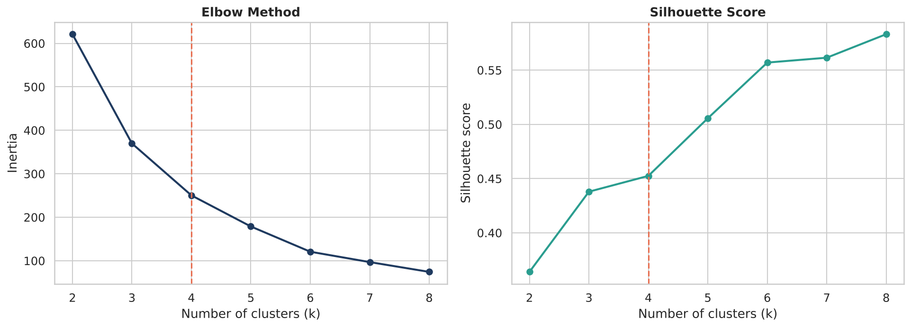
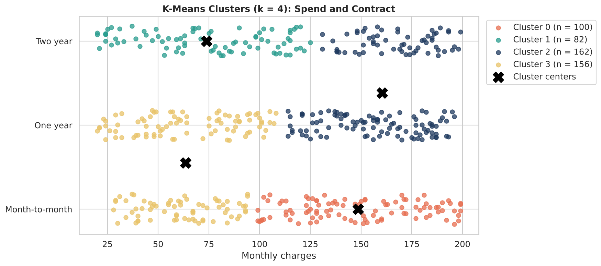
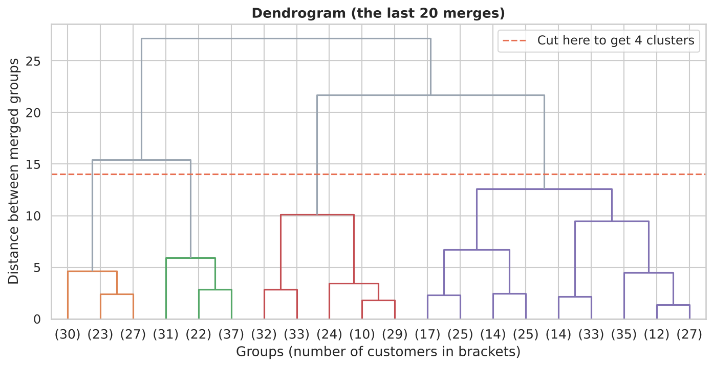
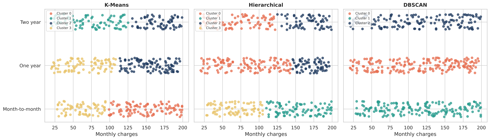
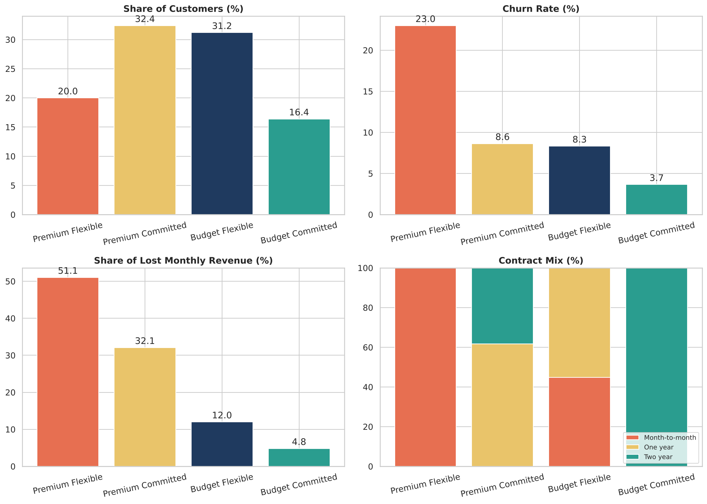
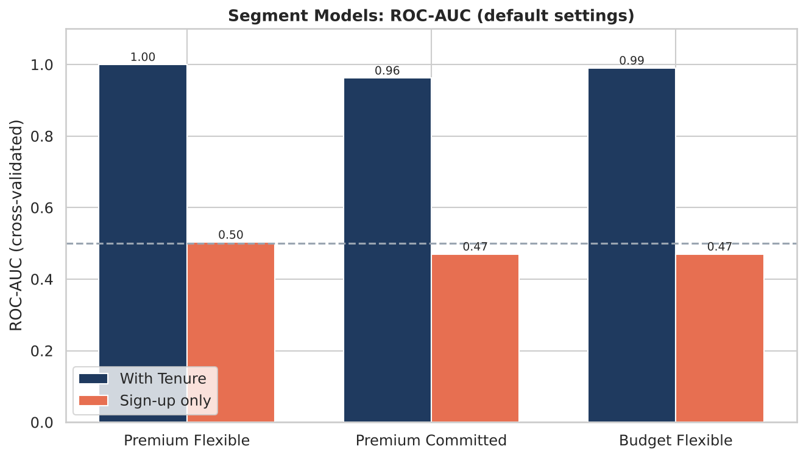
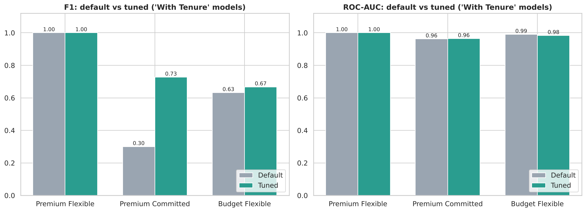

# Customer Segment Profiles

Week 11 - Advanced Machine Learning Models: Customer Segmentation and Prediction

## 1. Goal
Group the 500 customers into segments with clustering, describe each segment, build a separate churn prediction model for each segment that has enough data, tune the models, and turn the results into business recommendations.

## 2. How the segments were made
**Clustering features:** MonthlyCharges (how much a customer spends) and Contract (how committed the customer is: month-to-month 0, one year 1, two year 2). They describe customer value and commitment, which a company can act on. Tenure was not used because it is tied to churn; segments describe who the customer is, and churn is predicted inside each segment. Yes/no columns (SeniorCitizen, PaperlessBilling) were tested too, but they only split the data into arbitrary groups that were hard to explain. Both features were standardized (same scale) before clustering.

**Choosing the number of clusters (K-Means):**

| k | 2 | 3 | 4 | 5 | 6 | 7 | 8 |
|---|---|---|---|---|---|---|---|
| Inertia | 621 | 370 | 250 | 179 | 121 | 97 | 74 |
| Silhouette | 0.364 | 0.438 | 0.453 | 0.506 | 0.557 | 0.561 | 0.583 |

The elbow has no sharp bend; the curve flattens gradually after 3 to 4 clusters. Silhouette keeps rising with k because Contract has only 3 values, so more clusters look "cleaner". **k = 4** gives groups that are large enough to model and easy to explain.

## 3. Three clustering algorithms compared

| Algorithm | Clusters | Silhouette (higher is better) | Davies-Bouldin (lower is better) | Calinski-Harabasz (higher is better) | Smallest / largest cluster |
|---|---|---|---|---|---|
| K-Means (k = 4) | 4 | 0.453 | 0.705 | 494.9 | 82 / 162 |
| Hierarchical, Ward (k = 4) | 4 | 0.429 | 0.788 | 436.3 | 80 / 202 |
| DBSCAN (eps = 0.5) | 3 | 0.367 | 1.387 | 248.6 | 144 / 186 |

- **Hierarchical clustering** merges customers step by step (see the dendrogram below). It agrees only partly with K-Means (adjusted Rand index 0.50) and gives less balanced groups.
- **DBSCAN** finds only the 3 contract types (agreement with contract type 1.00). MonthlyCharges is spread evenly, with no dense groups or gaps, so density cannot split customers by spend. With a smaller reach (eps 0.15) it finds 4 groups but separates them less well (silhouette 0.324).
- **Decision:** K-Means is used for the segments. It has the best separation scores and balanced, easy-to-explain groups.

## 4. The four segments
Names come from a fixed rule: "Premium" if the cluster's average monthly charge is above the overall average (113.6), otherwise "Budget"; "Committed" if the average contract is one year or longer, otherwise "Flexible".

| | Premium Flexible | Premium Committed | Budget Flexible | Budget Committed |
|---|---|---|---|---|
| Customers (share) | 100 (20.0%) | 162 (32.4%) | 156 (31.2%) | 82 (16.4%) |
| Average monthly charge | 148.5 | 160.5 | 63.5 | 73.9 |
| Average tenure (months) | 36.6 | 35.8 | 37.7 | 35.7 |
| Month-to-month / one year / two year | 100% / 0% / 0% | 0% / 61.7% / 38.3% | 44.9% / 55.1% / 0% | 0% / 0% / 100% |
| Paperless billing | 40.0% | 51.9% | 48.7% | 52.4% |
| Senior citizens | 50.0% | 43.2% | 51.9% | 58.5% |
| Electronic check | 36.0% | 35.2% | 30.8% | 26.8% |
| Customers who left | 23 | 14 | 13 | 3 |
| **Churn rate** | **23.0%** | **8.6%** | **8.3%** | **3.7%** |
| Monthly revenue | 14,849 | 25,995 | 9,913 | 6,061 |
| Monthly revenue lost | 3,512 | 2,208 | 826 | 332 |
| Share of lost revenue | 51.1% | 32.1% | 12.0% | 4.8% |

**Profiles:**
- **Premium Flexible** - high spenders on month-to-month contracts. Only 20% of customers but **51% of the lost revenue**. Every customer in this segment who was in their first year left (23 of 23).
- **Premium Committed** - the biggest and most valuable group (32% of customers, 160 average charge) on one or two year contracts. 8.6% churn, 32% of lost revenue.
- **Budget Flexible** - low spenders with a mix of month-to-month and one-year contracts. 8.3% churn.
- **Budget Committed** - low spenders on two-year contracts. The safest segment: 3.7% churn, only 3 customers have left.

**Where the churn happens (first year, tenure 11 months or less):**

| Segment | First-year customers | Left | First-year churn | Customers after year 1 | Left after year 1 |
|---|---|---|---|---|---|
| Premium Flexible | 23 | 23 | 100.0% | 77 | 0 |
| Premium Committed | 23 | 14 | 60.9% | 139 | 0 |
| Budget Flexible | 26 | 13 | 50.0% | 130 | 0 |
| Budget Committed | 11 | 3 | 27.3% | 71 | 0 |

No customer who had been with the company 12 months or more has left, in any segment.

## 5. Prediction models for each segment
A segment needs at least 10 customers who left to get its own model, otherwise a model cannot learn or be tested reliably. Three segments qualify. **Budget Committed has only 3 churners, so it gets a watch-list of its 11 first-year customers instead of a model.**

Random Forest models (balanced class weights) were tested with 5-fold stratified cross-validation: every prediction is made on customers the model has not seen. Each model was run twice: **With Tenure**, and **Sign-up only** (no Tenure, only information known when a customer joins).

| Segment | Features | Accuracy | Precision | Recall | F1 | ROC-AUC |
|---|---|---|---|---|---|---|
| Premium Flexible | With Tenure | 1.000 | 1.000 | 1.000 | 1.000 | 1.000 |
| Premium Flexible | Sign-up only | 0.690 | 0.278 | 0.217 | 0.244 | 0.503 |
| Premium Committed | With Tenure | 0.914 | 0.500 | 0.214 | 0.300 | 0.962 |
| Premium Committed | Sign-up only | 0.895 | 0.000 | 0.000 | 0.000 | 0.470 |
| Budget Flexible | With Tenure | 0.955 | 1.000 | 0.462 | 0.632 | 0.990 |
| Budget Flexible | Sign-up only | 0.853 | 0.000 | 0.000 | 0.000 | 0.470 |

Always predicting "stays" would be right 77.0%, 91.4% and 91.7% of the time in these three segments, but would catch no churners.

**What this shows:**
1. **With Tenure the models look excellent, but this is probably too good.** All customers who left had a tenure of 11 months or less, and Tenure may be the time a customer stayed before leaving, which partly reveals the answer.
2. **Using only sign-up information the models do no better than guessing** (ROC-AUC about 0.5). The data does not support predicting churn for a new customer.
3. **One model for all customers** (also tested) scored as well as or better than the separate segment models (default settings) when Tenure was included (for example Budget Flexible F1 0.960 against 0.632). With so few churners, splitting the data leaves each model less to learn from. The value of segmentation here is in deciding who to contact and how, not in better predictions.

## 6. Hyperparameter tuning (Grid Search)
Grid Search tried 8 combinations (trees: 100 or 200; tree depth: 3 or unlimited; smallest leaf: 1 or 3) with 3 inner folds, choosing the best F1-score. The search ran **inside** each of the 5 outer folds (nested cross-validation), so the customers used to test a model were never used to choose its settings.

| Segment | Features | F1 default | F1 tuned | Recall default | Recall tuned | Precision default | Precision tuned | ROC-AUC default | ROC-AUC tuned |
|---|---|---|---|---|---|---|---|---|---|
| Premium Flexible | With Tenure | 1.000 | 1.000 | 1.000 | 1.000 | 1.000 | 1.000 | 1.000 | 1.000 |
| Premium Flexible | Sign-up only | 0.244 | 0.133 | 0.217 | 0.130 | 0.278 | 0.136 | 0.503 | 0.471 |
| Premium Committed | With Tenure | 0.300 | 0.727 | 0.214 | 0.857 | 0.500 | 0.632 | 0.962 | 0.964 |
| Premium Committed | Sign-up only | 0.000 | 0.000 | 0.000 | 0.000 | 0.000 | 0.000 | 0.470 | 0.437 |
| Budget Flexible | With Tenure | 0.632 | 0.667 | 0.462 | 0.615 | 1.000 | 0.727 | 0.990 | 0.983 |
| Budget Flexible | Sign-up only | 0.000 | 0.244 | 0.000 | 0.385 | 0.000 | 0.179 | 0.470 | 0.681 |

Best settings found (search on the whole segment): Premium Flexible with Tenure: depth 3, leaf 1, 100 trees; Premium Committed with Tenure: depth 3, leaf 3, 100 trees; Budget Flexible with Tenure: depth 3, leaf 1, 100 trees.

F1 was better than the default in 3 cases, about the same in 2 and worse in 1. The clearest gain is Premium Committed with Tenure (F1 0.300 to 0.727, recall 0.214 to 0.857). Tuning cannot create information that is not in the data: the sign-up-only ROC-AUC after tuning ranges from 0.44 to 0.68, and with 13 to 23 churners per segment those differences are mostly chance.

## 7. Feature importance
In the tuned "With Tenure" models, **Tenure is the top feature in every segment**:

| Segment | Top 3 features (importance) |
|---|---|
| Premium Flexible | Tenure (0.71), MonthlyCharges (0.19), SeniorCitizen (0.03) |
| Premium Committed | Tenure (0.55), MonthlyCharges (0.15), Pay_Bank Transfer (0.14) |
| Budget Flexible | Tenure (0.48), Contract (0.22), MonthlyCharges (0.13) |

This matches the warning about Tenure: it is a strong signal, but the models describe the past better than they predict new customers.

## 8. Testing evidence
- Every customer has a segment, segment sizes add up to 500, contract percentages add up to 100 in every segment, and the customers who left add up to 53.
- Cross-validation predictions are always made on unseen customers; the tuning search runs inside the folds (nested cross-validation).
- Accuracy is compared with the "always stays" baseline, and the segment models are compared with one model for all customers.
- Score spread between folds is reported (AUC standard deviation 0.000 to 0.199).

## 9. Limitations
- Only 500 customers and 53 churners; the smallest model-building segments have 13 and 14 churners, so all scores are uncertain.
- Tenure may reveal the outcome, so "With Tenure" scores are probably too optimistic.
- The segments are a division of continuous spending, not naturally separated groups (silhouette 0.45).
- The money figures in the business recommendations use assumptions about programme cost and effect.
